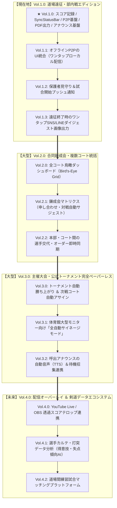

# 🥋 KendoSync 将来アップデート・ロードマップ（Vol.1.0 〜 Vol.4.0）

## 1. 概要と基本哲学

KendoSync（KendoOS同期基盤）は、**「体育館という過酷な現場（電波脆弱・突発的遮断）での絶対的な安心感」**と**「道場遠征から大規模大会までスムーズに拡張するスケーラビリティ」**を両立する剣道運営基盤です。

### 成長の基本軸
1. **引き算の現場UX**：規模が1コートから10コートに広がっても、現場の記録係（中高生・保護者）が触る画面はシンプルであり続ける（単機能スコアボードの維持）。
2. **ローカルファースト＆ハイブリッド同期**：オフライン下でもP2P/ローカルメッシュで止まらず稼働し、電波回復時に自動で差分同期する。
3. **共有のワンアクション化**：コートごとにURLを配らず、大会全体のポータルQRコード1枚で自動追尾。

---

## 2. ロードマップ全体図

---

## 3. 各バージョンの詳細仕様

### 🥋 【現在地】Vol.1.0：道場遠征・部内戦エディション（実装済基盤）
現在すでにKendoOSに組み込まれている高機能基盤です。

* **多彩な試合形式**: 個人戦、団体戦、勝抜戦、部内リーグ戦・総当たり
* **現場の安全性・監視**:
  * [SyncStatusBar](../../lib/shared/widgets/sync_status_bar.dart): 3段階同期ステータス（synced / syncing / pending）
  * `deadLetterQueueProvider`: 未送信・エラーデータの滞留防止と警告
  * `ThermalStatusBadge`: 炎天下・長時間使用時のスマホ熱暴走検知
* **共有・速報**:
  * [share_provider.dart](../../lib/features/tournament/presentation/operate/providers/share_provider.dart): ワンタップでクリップボード自動格納 ＆ Google Chart APIによるQRコード自動生成
  * [viewer_match_screen.dart](../../lib/features/viewer/presentation/viewer_match_screen.dart): 保護者・観覧者向けリアルタイムWebビュー
* **オフライン通信基盤**:
  * [local_p2p_broadcaster.dart](../../lib/features/p2p/infrastructure/local_p2p_broadcaster.dart): 端末内蔵WebSocket/HTTPサーバー（ポート8080）
* **公式記録**:
  * [pdf_service.dart](../../lib/features/pdf/pdf_service.dart): 公式記録のPDF印刷・Webダウンロード、画像化シェア
* **現場通信**:
  * [timeline_unified_announce_dialog.dart](../../lib/features/tournament/presentation/operate/components/timeline/timeline_unified_announce_dialog.dart): リアルタイムアナウンス・ポップアップ通知

---

### 🔹 Vol.1.x 系：遠征現場の「体験の摩擦をゼロにする」（マイナー改善）

| バージョン | 機能名 | 詳細と現場メリット |
| :--- | :--- | :--- |
| **Vol.1.1** | **オフラインP2PのUI統合** | 既存の `LocalP2pBroadcaster` をスコア画面から「オフライン配信用QR」としてワンタップで起動。電波のない体育館地下でも親機のQRを保護者が読むだけで即座に閲覧可能にする。 |
| **Vol.1.2** | **保護者見守り＆試合開始通知** | Web Viewer上で「自道場」や「自分の子供」をピン留め。他コートを見に行っていても「次、〇〇君の試合が始まります」「一本取りました！」が保護者スマホへプッシュ通知される。 |
| **Vol.1.3** | **遠征ダイジェスト画像出力** | 帰りの車内やバス内で、Instagramや道場LINEグループにそのまま貼れる「正方形・スマホサイズの戦績ハイライト画像」をワンタップ生成。 |

---

### 🌟 Vol.2.0【大型アップデート】：合同錬成会・複数コート統括

| バージョン | 機能名 | 詳細と現場メリット |
| :--- | :--- | :--- |
| **Vol.2.0** | **全コート鳥瞰ダッシュボード** | 本部席のiPadや監督のスマホで、全コート（第1〜8コート）の進行状況と対戦カードが1画面で見渡せる。「第3コートが遅れている」「自道場が代表戦」が一目瞭然。 |
| **Vol.2.1** | **錬成会マトリクス（申し合わせサジェスト）** | 錬成会特有の「午前は固定リーグ、午後は申し合わせ」の管理。「まだ対戦していない道場同士」を自動サジェストし、コート待ち時間を削減。 |
| **Vol.2.2** | **選手交代・オーダー即時同期** | 午後からのオーダー組み換えや怪我による選手交代を本部端末で入力すると、該当コートの記録係端末に自動反映。紙のオーダー票を持って走る必要がゼロに。 |

---

### 🌟 Vol.3.0【大型アップデート】：主催大会・公式トーナメント完全ペーパーレス

| バージョン | 機能名 | 詳細と現場メリット |
| :--- | :--- | :--- |
| **Vol.3.0** | **トーナメント自動勝ち上がり** | 1回戦終了後、勝者が自動的に2回戦枠へ進出し、空いたコートへ自動割り振り。壁面の模造紙にマジックで結果を書き込む作業が完全不要に。 |
| **Vol.3.1** | **全自動サイネージモード** | 体育館壁面のプロジェクターや大型モニターにHDMI接続するだけで、全コートの速報とトーナメント勝ち上がりを自動巡回表示（オペレーター不要）。 |
| **Vol.3.2** | **呼出アナウンスの音声合成（TTS）** | 「第2コート、次は〇〇道場と△△道場です」を本部スピーカーから自動音声読み上げ＆対象チーム端末へ招集通知。本部アナウンス係の負担を激減。 |

---

### 🌟 Vol.4.0【超大型アップデート】：配信オーバーレイ ＆ 剣道データエコシステム

| バージョン | 機能名 | 詳細と現場メリット |
| :--- | :--- | :--- |
| **Vol.4.0** | **YouTube Live / OBS 透過テロップ** | 試合画面を透過テロップ化してOBS等に取り込める専用URL出力。遠方の家族もテレビ中継のようなクオリティで視聴可能に。 |
| **Vol.4.1** | **Kendo Analytics（選手カルテAI）** | 蓄積された過去の全試合データから、「先鋒での決定率」「延長戦での勝率」「メン・コテの決まり手比率」「時間帯別失点傾向」を可視化し稽古指導に直結。 |
| **Vol.4.2** | **道場間練習試合マッチング** | KendoSyncを使う道場同士が、成績や学年構成を見て「今度練習試合をしませんか？」と遠征オファーを送り合えるプラットフォーム。 |

---

## 4. 規模が大きくなってもアプリが複雑化しない「5大鉄則」

現場の利用者（中高生・保護者ボランティア・年配の審判員）が混乱しないよう、KendoSyncが徹底するアンチ・複雑化設計です。

### 💡 コア思想：「人に考えさせない。裏側の仕組みが自動で解く」
機能が増えても現場の末端（記録係や保護者）に選択肢や設定画面を増やしません。「規模が100倍になっても、現場の末端がやることは1つも増やさない」アプローチを徹底します。

---

### 鉄則 1：【役割の完全分離】記録係の画面にはボタンを「1個も増やさない」
* **記録係の画面（スマホ）**:
  * 規模が10コートになっても、画面にあるのはこれまで通り**「メ・コ・ド・ツ」「タイマー」「1手取消」のみ**。
  * 他コートの状況、トーナメント組み換え、集計結果などの複雑な情報は画面から完全に排除（単機能スコアボードに徹する）。
* **複雑な操作は「本部席の1台」だけに隔離**:
  * トーナメントの変更や進行管理など、頭を使う操作は本部席（指導者や運営担当のiPad/PC）だけに閉じ込めます。

---

### 鉄則 2：【ゼロ・コンフィグ接続】文字入力・パスワードを現場から全廃
* 朝、各コートの記録係は、本部画面に表示された「コート接続QR」をスマホカメラで読み取るだけ。
* **ルームID・パスワード・コート番号・権限（Scorer）が全自動でセット完了**。手入力による接続ミスやパニックを完全ゼロ化します。

---

### 鉄則 3：【保護者の自動追尾】10コートあっても探させない
* **大会全体のQRコードは「たった1枚」**: コートごとに別々のURLを配らず、体育館入口やパンフレットに1枚貼るだけ。
* **自道場の自動追尾（ピン留め）**: 保護者は「自分の道場」をタップしておくだけで、選手がどのコートへ移動しても、画面が自動追尾して「自道場の現在のコート」を最上段に大きく表示します。

---

### 鉄則 4：【ミスの恐怖を消す】現場ファーストの3重セーフティネット
1. **超巨大な「1手取消（アンドゥ）」ボタン**: 間違えて押してもワンタップで直前の判定を取り消し可能。
2. **端末が落ちても「1秒復帰」**: 誤って画面を閉じたり端末再起動しても、アプリを開いた瞬間に直前のスコア・残り時間を即時復元。
3. **本部からの「遠隔レスキュー」**: 記録係が操作に迷って固まっても、本部席の端末から遠隔でスコア修正・タイマー再開を支援。

---

### 鉄則 5：【コード・設計の防波堤】ガバナンス規約による複雑化阻止
* **単一ファイル500行上限ルール**: 機能を詰め込みすぎて肥大化したファイルをCIスクリプトで機械的に検知・拒否。
* **UI・Domain・Syncの完全分離**: 通信機能やトーナメント進行が拡張されても、スコアボードの画面コードには一切影響を与えない堅牢なレイヤードアーキテクチャ。

---

## 📊 一目でわかる「規模拡大時の対比」

| 課題 | 失敗するアプリ | **KendoSyncの解決策** |
| :--- | :--- | :--- |
| **画面の操作** | 機能が増えてボタンやタブだらけになる | **記録係の画面は「メ・コ・ド・ツ」のまま一切増やさない** |
| **接続・設定** | ルームIDやパスワードを手入力させる | **カメラでQRを1回撮るだけで全自動接続（文字入力ゼロ）** |
| **保護者の共有** | コートごとに違うURLを配って大混乱 | **大会でQRは1つだけ。自道場を自動追尾して最上段表示** |
| **誤操作・トラブル** | 間違えると大会が止まりパニックになる | **巨大な1手取消 ＆ 本部からの遠隔修正レスキュー** |

