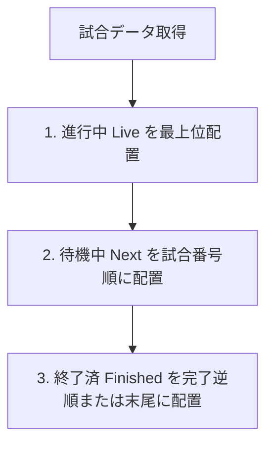

---
ai_metadata:
  screen: all_screens
  role: operator_admin
  risk: low
  governance_level: L1
  offline_supported: true
---
[総合ホーム](../manual_index.md) > [運営・記録マニュアル](index.md) > タイムライン表示仕様と免責事項

# タイムライン表示仕様と免責事項

大会ホーム画面および観客席タイムラインにおける試合カードの表示順序、状態遷移ロジック、およびシステム利用に関する公式免責事項を定めます。

---

## 1. タイムライン表示順序アルゴリズム {#timeline-ordering}

タイムライン上の試合カードは、現場の混乱を防ぐため以下の優先順位に従って決定論的（Deterministic）に整列されます。

1. **🔴 進行中の試合（In-Progress / Live）**:
   - 現在各コートで計時中・対戦中の試合が最上位にハイライト配置されます。
2. **🟡 待機中の試合（Waiting / Next）**:
   - 次に招集される試合順（`order` 昇順）に従って整列されます。
3. **⚪ 終了した試合（Finished / Approved）**:
   - すでに勝敗が確定した試合は、結果サマリーとともに安定して下部に保持されます。

---

## 2. 試合状態（Status）の不可逆遷移ロジック {#status-transition}

第502条 CRDT調停規約に基づき、試合状態は以下の不可逆ライフサイクルに従います。

* **`scheduled`（未開始・待機中）**: 試合作成直後またはオーダー確定待ち。
* **`in_progress`（進行中）**: タイマースタートまたは最初の打突が記録された状態。
* **`finished`（終了確定）**: 1.5秒長押しによりスコアが確定した状態。
* **`approved`（公式承認済）**: 本部による最終確認が完了した状態。
* **巻き戻りブロック（`resolveMonotonicStatus`）**:
  - ネットワーク遅延により古いパケットが遅れて届いても、終了済みの試合が勝手に未開始へ戻ることは数学的に遮断されます。

---

## 3. 公式免責事項と競技原則（最重要） {#disclaimer-and-principle}

Kendo OS は大会運営の円滑化と観客体験の向上のために開発された支援システムです。公式な競技運営においては、以下の原則が常に最優先されます。

### 3.1 物理ストップウォッチ（主時計）絶対の原則
* アプリ内のタイマーはミリ秒精度で同期されていますが、通信遅延や端末負荷により観客席Viewerや他端末との間でわずかな表示ラグが生じる場合があります。
* **公式な試合時間およびタイムアップの判定は、必ず各試合場のコート机上に置かれた物理ストップウォッチ（主時計）および計時員の旗・ブザーの宣告を最終基準とします。**

### 3.2 審判員宣告絶対の原則
* スコアボード上の有効打突、反則、勝敗の判定は、主審・副審の宣告に基づき記録員が入力したものです。
* システム表示と審判員の宣告に食い違いが生じた場合は、**全日本剣道連盟試合・審判規則に従い、審判員の宣告および審判主任・審判長の合議決定が絶対の正** となります。

### 3.3 通信障害時の継続原則
* 体育館の電波が遮断された場合でも、手元の端末内の超高速ローカルDB（Isar）により記録は保護されます。**通信エラーを理由に競技を中断させないでください。**

---

## 関連ページ
- [大会ホーム画面ガイド](home_guide.md)
- [試合の記録（タイマー・得点・反則）](match.md)
- [🚨 緊急復旧ガイド（現場トラブル即時解決）](../recovery/failure_catalog.md)
- [監視・同期ダッシュボード](../recovery/observability_dashboard.md)
