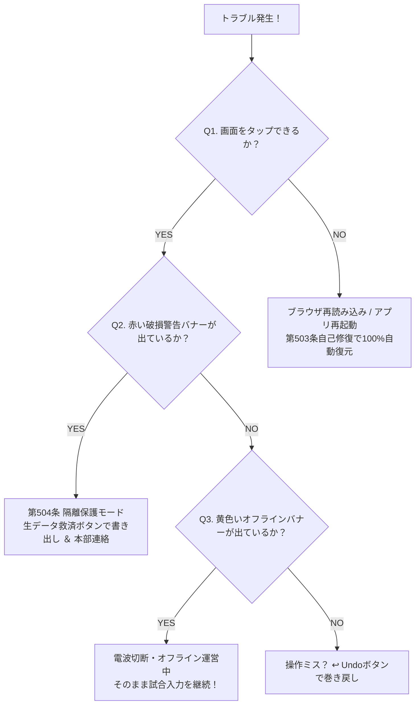

---
ai_metadata:
  screen: all_screens
  role: operator_admin
  risk: high
  governance_level: L3
  offline_supported: true
---
[総合ホーム](../manual_index.md) > 障害復旧・監査マニュアル > 緊急復旧ガイド

# 🚨 緊急復旧ガイド（現場トラブル即時解決）

**「システムが万が一止まっても、試合（競技）は絶対に止めない。」**
本ガイドは、大会現場で発生するあらゆる突発トラブルに対し、最短10秒で安全に対処・復旧するための現場マニュアルです。
本システムは **第503条 ツインエンジン自己修復規約** および **第504条 障害データ隔離規約** に完全適合しており、データ消失ゼロを数学的・構造的に保証しています。

---

## 1. 現場でのYES/NO即答診断チャート {#recovery-flow}

トラブルが発生した際は、慌てずに以下の3つの質問に答えてください。

### 【診断1】画面が固まってタップできない / ブラウザが真っ白になった
* 👉 **慌てずにブラウザの再読み込み（またはアプリ再起動）を行ってください。**
* **自己修復の根拠（第503条）**:
  - 全スコアイベントは端末の超高速ローカルDB（Isar）およびJSONバックアップ（ツイン永続化）へリアルタイムに二重保存されています。
  - OSの強制終了やブラウザクラッシュ時も、起動時に `EmergencyCrashPreserver` が直前の残り時間、得点、反則状態を **100%自動復元（Startup Restore）** します。

### 【診断2】画面上部に「⚠️ 体育館オフライン運営モード」と出ている
* 👉 **絶対にアプリを閉じないでください！ そのまま試合入力を継続してください。**
* これは故障ではなく、**「電波ゼロのため端末ローカルDBへ安全退避保存している」** という正常な保護サインです。
* タイマー計時、一本打突、反則、延長戦、確定まで、すべて通常通り動作します。電波が復帰した瞬間にバックグラウンドでクラウドへ自動一括送信されます。

### 【診断3】画面上部に赤色の「🚨 データ破損・隔離退避」警告が出ている
* 👉 **第504条 障害データ隔離モードが発動しています。**
* データの二次破壊を完全に防ぐため、当該試合の打突・タイマー操作は自動ロック（`allowEdit == false`）されます。
* バナー内の **【生データ書き出し（エクスポート）】** ボタンをタップしてテキスト/JSONデータを保存し、審判長または運営本部へ報告してください。観客用Viewer画面はパニック防止のため閲覧が継続されます。

---

## 2. 体育館の電波ゼロ・通信切断時（最重要運用） {#recovery-network}

体育館の奥深くや地下道場、Wi-Fiルーターの電源喪失などで電波が完全に途切れた場合：

1. **手元の端末で試合を最後まで記録する**:
   - オフライン時でもタイマーのミリ秒計時、スコア記録、勝敗確定は完全に動作します。
2. **完全べき等キューイング（二重加点の完全防止）**:
   - 各イベントには一意なUUIDが付与されているため、電波回復後に再送信が重なっても二重加点されることは絶対にありません。
3. **電波復帰時の自動同期**:
   - 本部席のWi-Fi圏内に戻るか電波が回復すると、未送信キュー（`PendingSyncQueue`）が自動フラッシュされ、観客・本部の画面へ最新結果が瞬時に反映されます。

---

## 3. 猛暑による端末の熱暴走・バッテリー低下時 {#recovery-thermal}

夏の体育館などでタブレットが高熱を持ったり、バッテリー残量が低下した場合：

1. **自動サーマル冷却ガバナーの発動**:
   - 端末発熱を検知すると、「⚡ 高速」➔「🔋 エコ冷却」➔「🌿 極限省電力」へ自動移行します。
   - 背景アニメーションの停止と描画頻度の間引きにより、端末温度の上昇を抑制します。
2. **計時精度の完全保証**:
   - どのような省電力モードであっても、タイマーの計時精度（第502条規約）は1ミリ秒も狂いません。
3. **手動対策**:
   - 直射日光を避け、うちわや保冷剤（結露防止のためタオル巻き）で端末背面を冷却してください。

---

## 4. スコアの押し間違い・取り消し（ヒューマンエラー） {#recovery-mistake}

* **直前の得点を取り消したい**:
  - 画面下の **【↩️ Undo】** ボタンをタップします。一本取得直後であれば「5秒カウントダウンUndoバー」からもワンタップで取り消せます。
* **すでに「確定」を押して次の試合に進んでしまった場合**:
  - 大会ホーム画面から対象の試合カードをタップし、結果画面からスコアを修正してください。すべての修正はシステム監査ログに透明に記録されます。

---

## 5. 万が一の端末物理故障時（予備端末への即時引き継ぎ） {#recovery-paper}

端末の落下破損、水没、完全放電などにより端末が完全に操作不能となった場合：

1. **即座に紙の記録用紙へ切り替え**:
   - 審判宣告を手書きでメモし、試合そのものは絶対に中断させず進行させます。
2. **予備端末（スマートフォンのブラウザでも可）を用意**:
   - 予備端末のブラウザでアプリを開き、同じ **道場ID（ルームID）** に参加します。
3. **コート権限の引き継ぎ**:
   - 担当コートを選択し、紙にメモしたスコアを追加入力して同期を復旧させます。

---

## 関連ページ
- [試合の記録（タイマー・得点・反則）](../operator/match.md)
- [システム設定（サンシャイン・省電力）](../operator/settings.md)
- [システム監視ダッシュボード](observability_dashboard.md)
- [監査ログの確認](../operator/audit_log.md)

## 困ったとき
- [点数の経緯をさかのぼりたい](../operator/audit_log.md#operate-audit-view)
- [電波が戻っても同期されない](observability_dashboard.md#sync-monitoring)