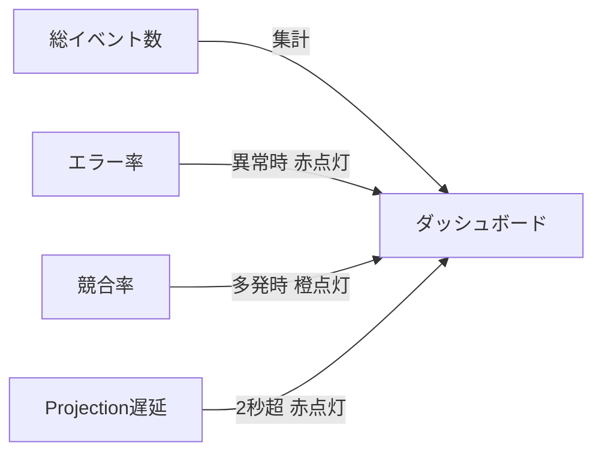

---
ai_metadata:
  screen: observability_dashboard_screen
  role: operator_admin
  risk: high
  governance_level: L3
  offline_supported: true
---
[総合ホーム](../manual_index.md) > [障害復旧・監査マニュアル](failure_catalog.md) > 運用ダッシュボード（Observability）

# 運用ダッシュボード（Observability）

大会進行中におけるシステム全体の健康状態、通信遅延、データ競合、分散同期メトリクスをリアルタイムに可視化する管理者専用の監視画面です。
本システムは **第501条 P2P現場ローカル配信規約** および **第502条 分散同期整合性・Clock Skew補正規約** に完全準拠しています。

---

## 1. リアルタイム健康状態メトリクス（4大カード） {#dashboard-metrics}

運用ダッシュボード（`/observability`）では、システムの健全性を表す4つの重要指標をカード形式で常時更新表示します。

| メトリクス名 | 表示項目 | 正常判定（🟢 緑色） | 警告・異常判定 | 想定される現場状況と対応 |
| :--- | :--- | :--- | :--- | :--- |
| **総イベント処理数** | `totalEvents` | 累計回数（青色） | ― | イベントソーシングで処理された打突・反則・タイマー等の総アクション数 |
| **システムエラー率 (直近)** | `errorRate` | **1.00% 以下** | 🔴 **1.00% 超過** | 通信切断や端末例外の急増。体育館Wi-Fiの再起動や端末状況を確認 |
| **同時書き込み競合率 (直近)** | `conflictRate` | **5.00% 以下** | 🟠 **5.00% 超過** | 同一コートへの二重操作。担当コートの端末割り当てを再確認 |
| **Projection遅延 (直近)** | `lastLagMs` | **2,000 ms (2秒) 以下** | 🔴 **2,000 ms 超過** | 通信回線の逼迫。観客側への配信遅延が発生しているためWi-Fi環境を点検 |

---

## 2. 端末間時刻ズレ（Clock Skew）自動補正（第502条規約） {#clock-skew-compensation}

大会現場では、各審判員や記録員のタブレット・スマートフォンの内部時計が数秒〜数分ずれていることが日常茶飯事です。

### 2.1 ミリ秒精度の自動オフセット補正
* 本システムは起動時および定期通信時に `ServerClockOffsetService` がNTP / クラウドサーバーとの時差（オフセット時間）をミリ秒単位で自動計測します。
* 端末内の時計が狂っていても、`SystemTimeSource` が内部で自動補正をかけるため、**試合タイマーの計時、合議、打突発生の順序関係は1ミリ秒も破綻しません**。

---

## 3. 分散同期・CRDT 3者マージ調停 {#crdt-sync-merger}

体育館の不安定なネットワーク環境下で複数端末が同時操作した場合でも、データが先祖返りしたり壊れたりしないための分散合流アーキテクチャです。

1. **3者イベントマージ (`SyncCrdtMerger`)**:
   - クラウド（リモート）、ローカル確定イベント、端末内保留キュー（未送信）の3者を自動調停し、矛盾のない1本のタイムラインへ合流させます。
2. **ステータス不可逆ガード (`resolveMonotonicStatus`)**:
   - 試合状態（未開始 ➔ 進行中 ➔ 終了確定）は、ネットワークの遅延パケットが遅れて届いても**「過去の状態へ勝手に巻き戻る」ことが数学的にブロック**されます。

---

## 4. 現場P2Pローカル配信メッシュ（第501条規約） {#p2p-mesh-delivery}

インターネット回線（光回線や携帯キャリア電波）が完全に落ちた場合でも、体育館内のローカルWi-Fiルーター（LAN）が存在していれば、**P2P（Peer-to-Peer）ローカル配信メッシュ** が自動作動します。

* クラウドサーバーを経由せず、コート主端末（スコア入力）からサブ端末（スコアボード表示）や審判席iPadへ直接UDP/TCPソケットで瞬時にスコアを配信します。
* これにより、会場全体の回線障害時にもスコアボード表示を完全維持できます。

---

## 関連ページ
- [🚨 緊急復旧ガイド（現場トラブル即時解決）](failure_catalog.md)
- [監査ログ・操作履歴（ゼロトラスト電子署名）](../operator/audit_log.md)
- [システム設定（サンシャイン・省電力）](../operator/settings.md)

## 困ったとき
- [遅延が2秒を超えて赤く点灯した](failure_catalog.md#recovery-network)
- [エラー率が上昇して警告が出た](failure_catalog.md#recovery-flow)